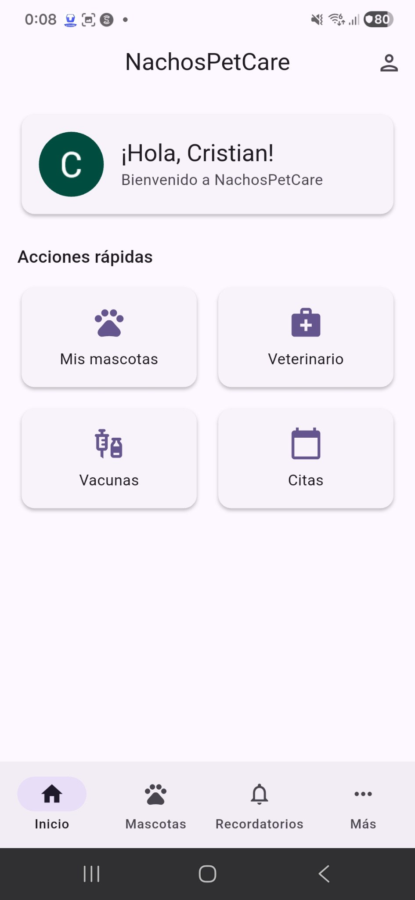
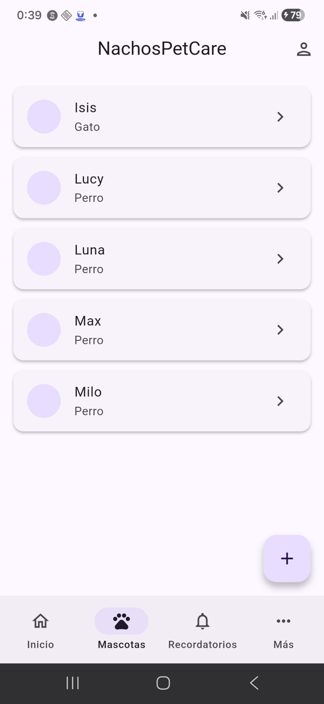
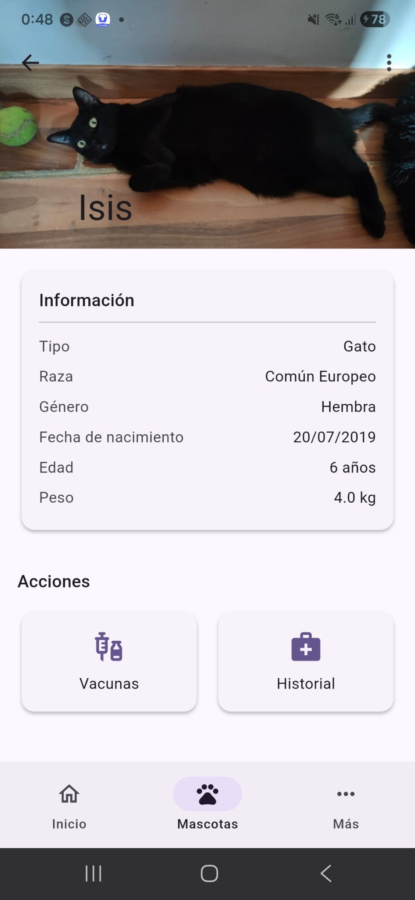
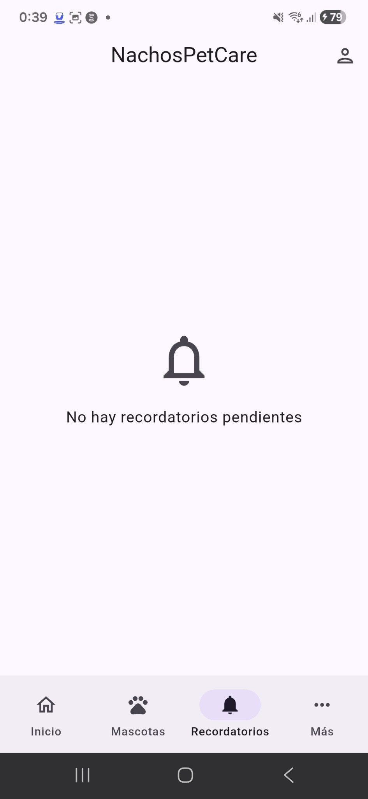
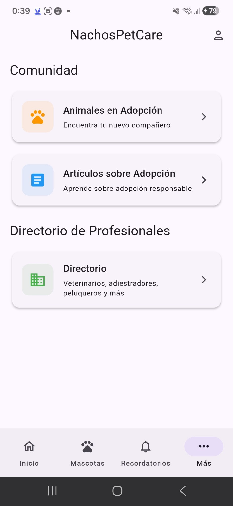
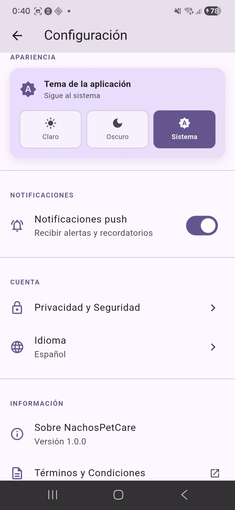
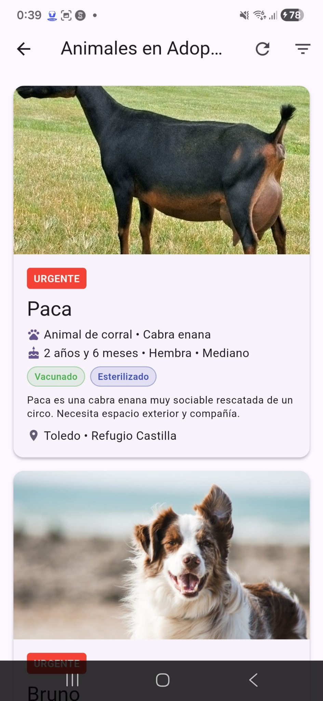
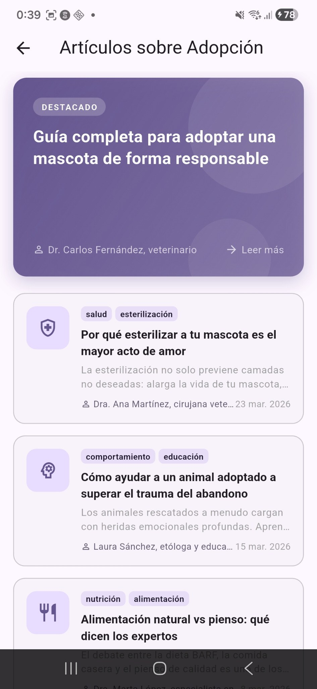
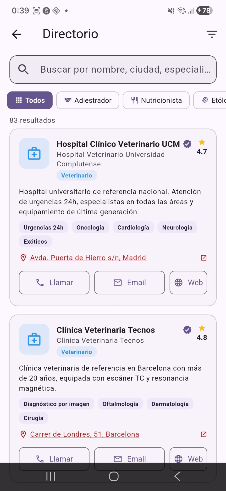

# 🐾 Nachos.PetCare

**Aplicación multiplataforma para organizar el cuidado de mascotas, consultar información útil y facilitar el acceso a recursos de adopción y profesionales veterinarios.**

   

**[Portfolio de Cristian González Couso](https://cristian-gonzalez-portfolio.vercel.app/)** · **[Código fuente](https://github.com/cgonzalezcouso/Nachos.PetCare)**

## Visión general

Nachos.PetCare reúne en una interfaz móvil varias tareas habituales relacionadas con el cuidado animal: consultar las fichas de las mascotas, acceder a sus apartados de vacunas e historial, revisar recordatorios y descubrir recursos sobre adopción responsable y servicios veterinarios.

Es un proyecto de desarrollo de aplicaciones multiplataforma orientado a demostrar competencias en **Flutter/Dart, organización modular, navegación, gestión de estado, persistencia de datos e integración de servicios**.

## Capturas reales de la aplicación

Las imágenes corresponden a pantallas de la aplicación en Android. Algunas muestran datos de demostración y contenido de terceros; no implican que todos los servicios externos estén disponibles permanentemente.

| Inicio | Mis mascotas | Ficha de mascota |
|:---:|:---:|:---:|
|  |  |  |

| Recordatorios | Comunidad | Configuración |
|:---:|:---:|:---:|
|  |  |  |

| Animales en adopción | Artículos de adopción | Directorio de profesionales |
|:---:|:---:|:---:|
|  |  |  |

## Funcionalidades y pantallas

- **Gestión de mascotas:** listado y fichas con fotografía y datos básicos, como especie, raza, edad o peso.
- **Seguimiento del cuidado:** accesos a vacunas e historial desde las fichas de mascotas.
- **Recordatorios:** sección específica para consultar avisos y tareas pendientes.
- **Comunidad y adopción:** consulta de animales en adopción y artículos informativos sobre adopción responsable.
- **Directorio de profesionales:** búsqueda y consulta de información de centros y especialistas veterinarios.
- **Perfil y preferencias:** opciones de cuenta, apariencia, idioma y notificaciones.

> Las capturas muestran estas pantallas y flujos de navegación. La disponibilidad efectiva de funciones que dependan de credenciales, permisos o servicios externos puede variar según el entorno de ejecución.

## Tecnologías

Tecnologías y paquetes identificados en el `pubspec.yaml` del repositorio:

| Área | Tecnología |
|---|---|
| Desarrollo multiplataforma | Flutter y Dart |
| Gestión de estado e inyección de dependencias | Provider, GetIt |
| Navegación | GoRouter |
| Backend y autenticación | Supabase Flutter, Google Sign-In |
| Persistencia local | SQLite (`sqflite`), SharedPreferences |
| Servicios y red | Dio |
| Notificaciones | Flutter Local Notifications, Firebase Messaging |
| Internacionalización | `flutter_localizations`, `intl` |
| Recursos y multimedia | Image Picker, Cached Network Image, Flutter SVG |
| Visualización y documentos | FL Chart, PDF, Share Plus |

**Nota:** la presencia de una dependencia en el proyecto no demuestra por sí sola que todas sus capacidades estén terminadas o activadas en producción.

## Organización del código

El repositorio separa responsabilidades en directorios de `lib/`:

```text
lib/
├── config/       # Configuración
├── data/         # Capa de datos
├── l10n/         # Recursos de localización
├── models/       # Modelos
├── providers/    # Gestión de estado
├── screens/      # Pantallas
├── services/     # Servicios e integraciones
├── utils/        # Utilidades
├── widgets/      # Componentes de interfaz
└── main.dart     # Punto de entrada
```

Documentación técnica existente: [arquitectura](docs/architecture.md), [modelo de datos](docs/er.md) y [plan de desarrollo](docs/plan.md).

## Puesta en marcha

**Requisitos:** Flutter SDK compatible con Dart `>=3.4.4 <4.0.0`, Android Studio o VS Code, y un dispositivo o emulador configurado.

```bash
git clone https://github.com/cgonzalezcouso/Nachos.PetCare.git
cd Nachos.PetCare
flutter pub get
flutter run
```

Para comprobar el entorno:

```bash
flutter doctor
```

Las funcionalidades conectadas a servicios externos pueden requerir configuración local y credenciales propias. **No publiques claves privadas, tokens ni archivos de configuración con secretos.**

## Qué demuestra este proyecto

- Construcción de interfaces móviles con Flutter y componentes reutilizables.
- Organización del código por capas y responsabilidades.
- Modelado de información relacionada con mascotas y su cuidado.
- Uso de bibliotecas de navegación, estado y almacenamiento.
- Diseño de una experiencia que integra gestión personal y consulta de recursos externos.

## Estado del proyecto

Proyecto de portfolio con código fuente y pantallas reales disponibles. La documentación describe las funcionalidades visibles y las tecnologías presentes en el repositorio; no representa una certificación de despliegue productivo, pruebas automatizadas completas ni disponibilidad continua de integraciones.

## Autor

**Cristian González Couso** — Técnico Superior en Desarrollo de Aplicaciones Multiplataforma (DAM).

- [Portfolio](https://cristian-gonzalez-portfolio.vercel.app/)
- [GitHub](https://github.com/cgonzalezcouso)

---

*Nachos.PetCare es un proyecto de software para gestión y consulta de información sobre mascotas. No sustituye la valoración de un profesional veterinario.*
